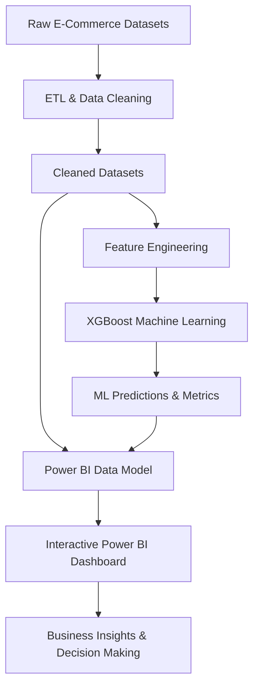

🛒 E-Commerce Analytics Platform


An end-to-end E-Commerce Data Analytics and Machine Learning Project built using Python, XGBoost, and Microsoft Power BI.

This project focuses on analyzing e-commerce sales, customer behavior, product performance, marketing effectiveness, and business operations. It also uses Machine Learning models to predict customer churn, sales performance, and product returns.

📌 Project Overview

The E-Commerce Analytics Platform transforms raw e-commerce data into meaningful business insights through data cleaning, feature engineering, machine learning, and interactive Power BI dashboards.

The project is designed to help businesses understand their sales performance, identify customer trends, monitor product returns, and make data-driven decisions.

🎯 Project Objectives
Analyze overall sales and profitability.
Understand customer purchasing behavior.
Identify customers at risk of churning.
Evaluate product performance.
Analyze marketing and discount effectiveness.
Monitor order delivery and return patterns.
Predict sales performance using Machine Learning.
Predict customer churn and product returns.
Present business insights through interactive dashboards.

🛠️ Technologies Used
Technology	Purpose
Python	Data processing and ETL
Pandas & NumPy	Data cleaning and manipulation
XGBoost	Machine Learning models
Scikit-learn	Model evaluation and preprocessing
Microsoft Power BI	Interactive dashboards
CSV / Excel	Data storage and documentation
Jupyter / Google Colab	Model development and analysis

🏗️ Project Architecture


## 🏗️ Project Architecture

The project follows an end-to-end data analytics and machine learning workflow.



### Project Components

| Component | Description |
|---|---|
| DATA | Raw and cleaned datasets |
| ETL | Five Python scripts for dataset cleaning |
| Feature Engineering | Preparation of analytical and ML features |
| ML | XGBoost classification and regression models |
| POWERBI | Interactive business intelligence dashboard |
| DOCS | Data dictionary, architecture and ML documentation |

### Repository Structure

```text
ecommerce/
├── DATA/
│   ├── SOURCE/
│   └── cleaned/
├── ETL & FEATURE ENGINEERING/
├── ML/
├── POWERBI/
├── PROJECT DOCS/
└── README.md
```


📂 Project Folder Structure
text
ecommerce/
│
├── DATA/
│
├── ETL & FEATURE ENGINEERING/
│
├── ML/
│
├── POWERBI/
│
└── PROJECT DOCS/

Folder Description
DATA: Raw and cleaned e-commerce datasets.
ETL & FEATURE ENGINEERING: Python scripts for data cleaning, transformation, and feature creation.
ML: XGBoost machine learning implementation and prediction outputs.
POWERBI: Power BI dashboard and related files.
PROJECT DOCS: Project documentation, architecture, data dictionary, and supporting reports.

📊 Dataset Information

The main cleaned analytical dataset contains:

Total transactions: 138,116
Total customers: 24,911
Data period: January 2021 – December 2025

The project uses multiple datasets covering customer information, products, orders, and sales transactions.

🤖 Machine Learning Models

Three major prediction areas were developed using XGBoost.

1. Customer Churn Prediction

Objective: Identify customers who are likely to stop purchasing.

Target: churn_target
Model: XGBoost Classifier
Accuracy: 91.86%
Precision: 94.51%
Recall: 93.89%
F1-Score: 94.20%
ROC-AUC: 0.9245
2. Sales Prediction

Objective: Predict sales performance and estimate net sales.

Sales Classification:

Model: XGBoost Classifier
Accuracy: 92.40%
F1-Score: 92.39%
ROC-AUC: 0.9341

Sales Regression:

Model: XGBoost Regressor
MAE: 49.39
RMSE: 106.70
R² Score: 0.9917
MAPE: 4.95%
3. Product / Order Return Prediction

Objective: Predict whether an order is likely to be returned.

Model: XGBoost Classifier
Accuracy: 93.43%
Recall: 92.50%
F1-Score: 65.86%
ROC-AUC: 0.9385

Note: These metrics represent the evaluated model results on the project's test data. Classification metrics should be considered together, especially when target classes are imbalanced.

📈 Power BI Dashboard

The project includes interactive Power BI reports covering the following business areas:


## 📸 Power BI Dashboard Screenshots

### 1. Executive Overview


### 2. Sales & Profitability


### 3. Customer Analytics


### 4. Product Analytics


### 5. Marketing Analytics


### 6. Operations & Delivery


### 7. Returns & Customer Experience


### 8. Sales ML Predictions


### 9. Churn ML Predictions


### 10. Return ML Prediction


The dashboards combine business KPIs, analytical visuals, filters, and machine learning prediction results.

💡 Key Business Insights
Customer purchase frequency plays an important role in churn prediction.
Customers with longer gaps between purchases show increased churn risk.
Discount-related features are important in return prediction.
Sales patterns and customer behavior provide useful information for business planning.
Machine Learning predictions can support customer retention and operational decisions.

🚀 Project Outcomes
Developed an end-to-end data analytics workflow.
Prepared multiple datasets for analytical reporting.
Implemented XGBoost classification and regression models.
Evaluated models using appropriate performance metrics.
Developed interactive Power BI dashboards.
Connected business analysis with machine learning predictions.

👨‍💻 Author

Mannam Manoj

Associate Software Engineer | Data Analytics | Python | Machine Learning | Power BI

GitHub:https://github.com/manojmannam19/ecommerce.git

This project was developed as an end-to-end analytical implementation for learning and demonstrating data analytics, machine learning, and business intelligence skills.
