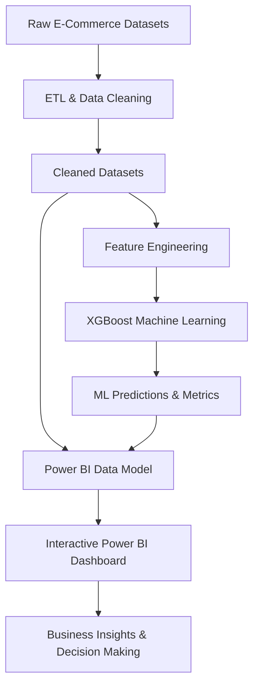

🛒 E-Commerce Analytics Platform


An end-to-end E-Commerce Data Analytics and Machine Learning Project built using Python, XGBoost, and Microsoft Power BI.

This project focuses on analyzing e-commerce sales, customer behavior, product performance, marketing effectiveness, and business operations. It also uses Machine Learning models to predict customer churn, sales performance, and product returns.

📌 Project Overview

The E-Commerce Analytics Platform transforms raw e-commerce data into meaningful business insights through data cleaning, feature engineering, machine learning, and interactive Power BI dashboards.

The project is designed to help businesses understand their sales performance, identify customer trends, monitor product returns, and make data-driven decisions.

🎯 Project Objectives
Analyze overall sales and profitability.
Understand customer purchasing behavior.
Identify customers at risk of churning.
Evaluate product performance.
Analyze marketing and discount effectiveness.
Monitor order delivery and return patterns.
Predict sales performance using Machine Learning.
Predict customer churn and product returns.
Present business insights through interactive dashboards.

🛠️ Technologies Used
Technology	Purpose
Python	Data processing and ETL
Pandas & NumPy	Data cleaning and manipulation
XGBoost	Machine Learning models
Scikit-learn	Model evaluation and preprocessing
Microsoft Power BI	Interactive dashboards
CSV / Excel	Data storage and documentation
Jupyter / Google Colab	Model development and analysis

🏗️ Project Architecture


## 🏗️ Project Architecture

The project follows an end-to-end data analytics and machine learning workflow.



### Project Components

| Component | Description |
|---|---|
| DATA | Raw and cleaned datasets |
| ETL | Five Python scripts for dataset cleaning |
| Feature Engineering | Preparation of analytical and ML features |
| ML | XGBoost classification and regression models |
| POWERBI | Interactive business intelligence dashboard |
| DOCS | Data dictionary, architecture and ML documentation |

### Repository Structure

```text
ecommerce/
├── DATA/
│   ├── SOURCE/
│   └── cleaned/
├── ETL & FEATURE ENGINEERING/
├── ML/
├── POWERBI/
├── PROJECT DOCS/
└── README.md
```


📂 Project Folder Structure
text
ecommerce/
│
├── DATA/
│
├── ETL & FEATURE ENGINEERING/
│
├── ML/
│
├── POWERBI/
│
└── PROJECT DOCS/

Folder Description
DATA: Raw and cleaned e-commerce datasets.
ETL & FEATURE ENGINEERING: Python scripts for data cleaning, transformation, and feature creation.
ML: XGBoost machine learning implementation and prediction outputs.
POWERBI: Power BI dashboard and related files.
PROJECT DOCS: Project documentation, architecture, data dictionary, and supporting reports.


## 🔄 ETL & Feature Engineering

The ETL pipeline was developed using Python and Pandas to clean and transform five raw e-commerce datasets.

### ETL Workflow

```text
Extract
   ↓
Clean
   ↓
Transform
   ↓
Feature Engineering
   ↓
Validate
   ↓
Save Cleaned Dataset
```
📊 Dataset Information

The main cleaned analytical dataset contains:

Total transactions: 138,116
Total customers: 24,911
Data period: January 2021 – December 2025

The project uses multiple datasets covering customer information, products, orders, and sales transactions.

### Dataset-wise ETL Implementation

| Dataset | Cleaning & Transformation | Feature Engineering |
|---|---|---|
| Customer Master | Standardized columns, handled missing values, removed duplicate customers, cleaned text and customer IDs, standardized gender and age | Age Group, Acquisition Cost Group, High Acquisition Cost Flag, Customer Location and Customer Profile |
| Product Catalog | Cleaned product IDs and text, handled missing values, removed duplicates, converted price and rating fields to numeric | Profit per Unit, Profit Margin %, Rating Category and Price Category |
| Order Items | Cleaned order and product IDs, handled missing values, removed duplicates, converted numerical fields and validated quantities and prices | Effective Discount Rate, Profit Margin %, Order Value Group, Profit Status and Discount Category |
| E-Commerce Sales | Cleaned transaction records, standardized dates and columns, handled missing values and duplicates, validated numerical and financial fields | Order Year, Order Month, Year-Month, Age Group, Delivery Variance, Effective Discount Rate, Profit Status and Return Flag |
| Dataset Statistics | Standardized columns, removed empty columns and duplicate rows | No additional feature engineering was required because it is a one-row reference dataset |

### Data Quality Validation

The ETL process included validation checks such as:

- Removing duplicate customer, product and order records.
- Checking missing and invalid values.
- Standardizing IDs, text fields and column names.
- Converting numerical and date columns into appropriate data types.
- Validating positive quantities and non-negative financial values.
- Checking unique IDs and important business rules.

### Output

The cleaned datasets were saved as separate CSV files.

The original raw datasets were preserved, allowing the cleaned data to be used for Machine Learning and Power BI reporting.

🤖 Machine Learning — XGBoost Models

The E-Commerce Analytics Platform includes three machine learning models developed using XGBoost to support sales forecasting, customer churn identification, and return risk prediction.

1. Machine Learning Models
   
Model	                    Algorithm	    Prediction Target   	 ML Type
Sales Prediction	        XGBRegressor	net_sales	             Regression
Customer Churn Prediction	XGBClassifier	churn_target	         Classification
Return Risk Prediction  	XGBClassifier	is_returned	             Classification

2. Model Details and Results
A. Sales Prediction Model
Algorithm: XGBRegressor
Target: net_sales
Purpose: Predicts the sales amount for an order.
Type: Regression
Evaluation Metric	Result

MAE             	49.39
RMSE	            106.70
R² Score	        0.9917
MAPE	            4.95%

The model achieved an R² score of 0.9917, explaining approximately 99.17% of the variation in sales. The MAPE of 4.95% indicates that the average percentage prediction error was approximately 4.95%.

B. Customer Churn Prediction Model
Algorithm: XGBClassifier
Target: churn_target
Purpose: Identifies customers who are likely to stop purchasing.
Type: Classification

Target values:

0 = Active
1 = Churned
Evaluation Metric	    Result
Accuracy	            91.86%
Precision	            94.51%
Recall	                93.89%
F1 Score	            94.20%
ROC-AUC                	0.9245

The model correctly classified 91.86% of customers as Active or Churned. Its recall of 93.89% indicates that it detected a high proportion of actual churned customers.

C. Return Risk Prediction Model
Algorithm: XGBClassifier
Target: is_returned
Purpose: Predicts whether an order is likely to be returned.
Type: Classification

Target values:

0 = Retained
1 = Returned

Evaluation Metric	    Result
Accuracy	            94.43%
Precision	            53.14%
Recall	                94.50%
F1 Score	            68.86%
ROC-AUC	                0.9585

The model achieved 94.43% accuracy and detected 94.50% of actual returned orders. Precision of 53.14% indicates that some orders predicted as returns were not actually returned.

3. Machine Learning Workflow

The models follow a structured workflow:

Load the cleaned e-commerce datasets.
Select relevant input features.
Define the target variable for each model.
Perform data preprocessing and encoding.
Split the data into training and testing sets.
Handle class imbalance where required for classification.
Train the XGBoost models.
Generate predictions.
Evaluate model performance using suitable metrics.
Export prediction results for Power BI dashboards.

4. Technologies Used
Technology	        Purpose
Python	            Model development
Pandas	            Data loading and manipulation
NumPy	            Numerical operations
XGBoost	            Machine learning algorithms
Scikit-learn	    Preprocessing and model evaluation
Google Colab	    Model development and execution

6. Machine Learning Outputs

The generated model outputs are used in Power BI to compare actual and predicted values and analyze model performance.

Sales: Actual vs. predicted sales and regression error metrics.
Churn: Actual vs. predicted customer churn and churn risk analysis.
Returns: Actual vs. predicted return status and return risk analysis.

These models extend the project beyond descriptive reporting by adding predictive insights to support business analysis.


## 📸 Power BI Dashboard Screenshots

### 1. Executive Overview


### 2. Sales & Profitability


### 3. Customer Analytics


### 4. Product Analytics


### 5. Marketing Analytics


### 6. Operations & Delivery


### 7. Returns & Customer Experience


### 8. Sales ML Predictions


### 9. Churn ML Predictions


### 10. Return ML Prediction


The dashboards combine business KPIs, analytical visuals, filters, and machine learning prediction results.

💡 Key Business Insights
Customer purchase frequency plays an important role in churn prediction.
Customers with longer gaps between purchases show increased churn risk.
Discount-related features are important in return prediction.
Sales patterns and customer behavior provide useful information for business planning.
Machine Learning predictions can support customer retention and operational decisions.

🚀 Project Outcomes
Developed an end-to-end data analytics workflow.
Prepared multiple datasets for analytical reporting.
Implemented XGBoost classification and regression models.
Evaluated models using appropriate performance metrics.
Developed interactive Power BI dashboards.
Connected business analysis with machine learning predictions.

👨‍💻 Author

Mannam Manoj

Associate Software Engineer | Data Analytics | Python | Machine Learning | Power BI

GitHub:https://github.com/manojmannam19/ecommerce.git

This project was developed as an end-to-end analytical implementation for learning and demonstrating data analytics, machine learning, and business intelligence skills.
